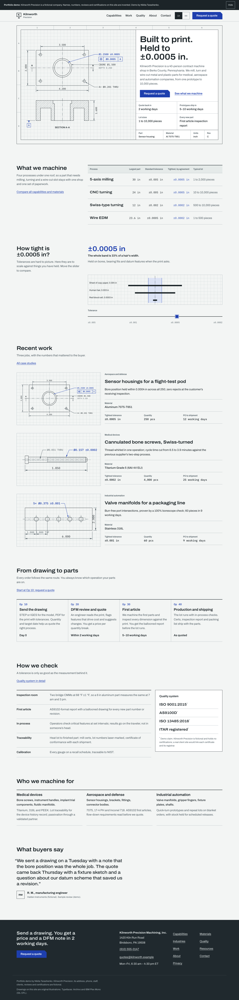

# Kilnworth Precision: website for a contract CNC machine shop (portfolio demo)

**This is a portfolio demo.** Kilnworth Precision is a fictional company. Its address, phone, staff, customers, reviews and certifications are invented. Every page says so in a strip at the top and a line in the footer, and the site is set to `noindex`. Demo by Nikita Tarashenko.

It shows the kind of site we build for B2B manufacturers: one whose job is to turn an engineer's visit into a request for quote (RFQ).



What is on it:

- A home page built around an engineering drawing of a real-looking part, with the headline in the drawing's title block.
- A three-step quote form (part, requirements, contact) with file checks for STEP, IGES, DWG, DXF and PDF up to 25 MB. A buyer without a drawing can describe the part instead (then the description is required). Its server side (`api/`, `server/`) validates again, stores files in Vercel Blob and emails the shop through Resend; it runs in mock mode without any keys (see "Quote form backend").
- A capability explorer: pick material, part size and tolerance, see which processes fit. Filters live in the URL, so a link can be shared.
- A tolerance ruler that draws ±0.005 in to ±0.0002 in to scale against paper, a hair and a blood cell.
- An inch/mm switch for the whole site, remembered in the browser.
- A printable one-page capability sheet (print `/capabilities`).
- 22 pages: capabilities (5 processes), materials, industries, quality, 3 case studies, about, 2 articles, contact, privacy, 404.

Design notes and the reasoning behind them: [DESIGN.md](DESIGN.md). Security review: [SECURITY-CHECKLIST.md](SECURITY-CHECKLIST.md). Fonts and image sources: [CREDITS.md](CREDITS.md).

## Run it locally

Needs Node 22.23.4 or newer (see `.nvmrc`).

```sh
npm install
npm run dev        # http://localhost:4321, reloads on save
```

Production build and a local preview of it:

```sh
npm run build      # writes dist/
npm run preview    # serves dist/ at http://localhost:4321 (runs in the background)
npx astro preview stop
```

Checks (all should pass before a deploy):

```sh
npm run check        # TypeScript and Astro type check
npm test             # unit tests (units, tolerance ruler, filter, form validation, quote API)
npm run smoke:rfq    # quote API end to end in mock mode (see "Quote form backend")
npm run build && npm run check-links   # every internal link in dist/ resolves
npm audit            # dependency vulnerabilities
```

Screenshots and a sideways-scroll check (preview must be running):

```sh
npm run shoot                    # standard set into docs/screenshots/
npm run shoot -- /rfq 390 rfq.png  # one page at one width
npm run shoot -- --overflow      # every page at 360–1920 px, reports horizontal scroll
```

## Stack, and why

| Piece | Why |
|---|---|
| [Astro](https://astro.build) 7, static output | Ships HTML with almost no JavaScript (1.6–3 KB gzipped per page; the quote page about 7.5 KB, plus 28 KB for the Blob upload client loaded only when a file goes to Blob). Content lives in Markdown and JSON, separate from layout. Hosts free on Vercel. |
| TypeScript, strict | Content files are checked against schemas at build time; a typo in a case study fails the build with the field name. |
| Plain CSS with tokens | One `tokens.css` holds every color, size and space. No Tailwind or UI kit: this site needs its own visual system, and plain CSS is the easiest for the next person to read. |
| Vanilla TypeScript for the interactive parts | Four small scripts. The logic (filtering, unit conversion, validation) is in `src/lib/` as plain functions with unit tests. |
| Fontsource (Archivo, IBM Plex Mono) | Fonts are self-hosted: no requests to Google, faster first paint, simpler privacy. |
| Vitest | Fast tests for `src/lib/`. |

## Project layout

```
src/
  config/site.ts        name, phone, email, address, nav, demo/noindex flags   <- start here
  content/
    processes/*.md      one file per capability page (numbers in front matter, text below)
    cases/*.md          case studies
    resources/*.md      articles
    materials.json      materials table and form options
  content.config.ts     the rules each content file must follow
  pages/                one file per URL (pages/work/[slug].astro makes /work/<file name>)
  components/           layout pieces; drawings/ holds the SVG drawings; interactive/ the scripts
                        (small components keep styles in <style>; bigger ones in a sibling .css
                        file such as hero.css or rfq.css, every selector starting at the root class)
  lib/                  plain logic with tests next to it (*.test.ts); api.ts and upload.ts are
                        the quote form's browser side of the API
  styles/               tokens.css, base.css, layout.css, print.css
public/                 favicon, og.png, boot.js (applies saved preferences before paint)
api/                    Vercel Functions: rfq.ts, upload.ts (thin wrappers)
server/                 quote form logic: validate, mail templates, adapters/ (mail, storage, rate limit)
scripts/                check-links.mjs, shoot.mjs, dev-api.mjs (local API), rfq-smoke.mjs
vercel.json             security headers, clean URLs and function limits for Vercel
.env.example            every environment variable, explained, without values
```

## Changing content

**Phone, email, address, hours, company name:** edit `src/config/site.ts`. Every page, the footer and the structured data read from there.

**Add a case study:** copy `src/content/cases/valve-manifold-316l.md` to a new file, for example `src/content/cases/pump-shaft-17-4.md`. Edit the front matter (title, industry, material, tolerance as a string like `'0.0005'`, quantity, leadDays, result, drawing) and the text. It appears on `/work`, on the home page and at `/work/pump-shaft-17-4`. `drawing` must be one of `housing`, `shaft`, `manifold`; a new drawing means a new component in `src/components/drawings/`.

**Edit a capability:** the numbers (envelope, tolerances, materials) are in the front matter of `src/content/processes/<name>.md`; the page text is below it. The home table, the explorer, the process page and the print sheet all update.

**Add a material:** add an entry to `src/content/materials.json` (`id`, `name`, `family`, `note`), then add its `id` to the `materials:` list of each process that can cut it.

**Add an article:** add a Markdown file to `src/content/resources/` with `title`, `summary`, `published` and `author`.

**Dimensions in inches:** write them as strings (`'2.250'`) so trailing zeros survive. Components show them in inches or millimeters depending on the visitor's choice. Numbers typed inside Markdown prose are plain text and do not switch units.

Run `npm run build` after editing: if a field is missing or wrong, the error names the file and field.

## Before using it for a real client

1. **Remove the demo labels and allow indexing.** In `src/config/site.ts` set `demo: false` and `noindex: false`. That removes the top strip and footer line and the `noindex` meta tag, turns on `sitemap-index.xml` (not generated while the site is noindex), and switches `robots.txt` to allow crawling with a sitemap link.
2. **Replace the fictional facts:** contacts in `site.ts`, the review in `src/components/home/Review.astro`, people in `src/pages/about.astro`, and the certification list in `src/components/home/Quality.astro` (link each real certificate).
3. **Set the real domain** in `astro.config.mjs` (`site:`), then regenerate the social image (below).
4. **Connect the quote form:** follow [SETUP-KEYS.md](SETUP-KEYS.md), then set `MAIL_TO_SHOP` to the shop's real inbox and remove `MAIL_TEST_RECIPIENT` once a domain is verified in Resend.

### Quote form backend

The server side of the quote form is two Vercel Functions in `api/` (thin wrappers) with all logic in `server/` (plain functions, tested without Vercel). It works on a fresh clone with **no accounts and no keys**: without keys it runs in mock mode and says so in the console. When the owner adds Resend and Vercel Blob, the only change is environment variables: see [SETUP-KEYS.md](SETUP-KEYS.md).

```
browser                         api/upload.ts            Vercel Blob (private store)
  | 1. "may I upload bracket.step?" ->|  checks name, size, origin, limit
  |<-- short-lived token -------------|
  | 2. file bytes, straight to Blob ------------------------------>|
  |                                   api/rfq.ts
  | 3. JSON: fields + [{url, name, size}] ->|  validates, looks every file up in storage,
  |<-- { ok: true, id: "KP-..." } ----------|  checks its first bytes, sends two emails
```

Files never pass through a function (they are capped at 4.5 MB); the browser sends them directly to Blob with a token the server hands out after checking the file name, extension and size. `/api/rfq` then trusts nothing the browser says about the files: it asks the storage for the real size and first bytes of each one.

#### In the browser

`src/components/interactive/rfq.ts` runs the form; the network part is in `src/lib/` and tested with a replaced `fetch`:

- `upload.ts`: one file at a time, `POST /api/upload` for permission, then the bytes with `put()` (Blob) or a plain `PUT` (local mock, through `XMLHttpRequest` for the progress bar). Files already in storage are remembered, so a retry after an error does not upload them again; when `/api/rfq` reports a file problem, the files are uploaded again on the next try.
- `api.ts`: `postJson()` with a 30 s timeout and one error type. Server messages are shown as they are, next to their field (with the focus on the first one, on its step) or, for `form` and `files`, in the box above the send button. No connection, a timeout, or an answer without JSON (a proxy error page) get a plain message with the shop's phone and email.
- `rfq-rules.ts` `requestBody()` builds the JSON from the form's own fields; a test runs it through the server's validation.
- While sending, the button is disabled and reads "Sending…", a status line (`role="status"`) says which file is uploading, and a second click does nothing. The confirmation shows the real request number.
- Without JavaScript the form stays readable but cannot send (files can only upload with JS); a note gives the shop's email and phone.

Screenshots of the states: `docs/screenshots/rfq-*.png`.

#### Run it locally (mock mode)

```sh
npm run dev:api     # terminal 1: the API on http://localhost:8787 (a stand-in for Vercel Functions)
npm run dev         # terminal 2: the site on http://localhost:4321; /api is forwarded to the API
```

- Emails are written to `.local/outbox/` as `.json` and `.html` (open the `.html` to see the mail as the reader would). A request makes two: the shop's copy and the buyer's auto-reply, with the same request number.
- Uploaded files land in `.local/uploads/`.
- `.local/` is ignored by git. Delete it any time.
- Values in `.env` or `.env.local` (both ignored by git) are loaded by `npm run dev:api`, so test keys can be tried locally too.
- `npm run smoke:rfq` plays a browser against a fresh API and checks the whole flow (24 MB and 26 MB files, `.exe`, a program renamed to `.step`, honeypot, wrong origin, the rate limit). It needs nothing but Node.

#### API

Every response is JSON with `Cache-Control: no-store`. Errors always look like `{ "ok": false, "errors": { "<field>": "<message>" } }`. The messages are written for the visitor; show them as they are. `errors.form` is for problems that belong to no field. Responses never contain stack traces or internal messages. Requests need an `Origin` header that matches the site (the browser adds it); on localhost any `localhost` origin is accepted.

**`POST /api/rfq`**: send a quote request. Body is JSON, at most 32 KB, `Content-Type: application/json`.

| Field | Type | Rule |
|---|---|---|
| `part` | string | required, up to 120 characters |
| `description` | string | up to 2000; **required when `files` is empty** |
| `process` | string | required, one of the ids in `PROCESS_OPTIONS` |
| `material` | string | required, one of `MATERIAL_OPTIONS` |
| `quantity` | number or digit string | required, whole number 1 to 100000 |
| `breaks` | string | up to 80 |
| `tolerance` | string | required, one of `TOLERANCE_OPTIONS` |
| `finishing`, `docs` | array of strings | each from `FINISHING_OPTIONS` / `DOCS_OPTIONS`, no repeats |
| `date` | string `YYYY-MM-DD` | optional, after today (the server counts days in UTC and also accepts yesterday, so a visitor in a late time zone is not refused after Send) |
| `notes` | string | up to 2000 |
| `name` | string | required, up to 80 |
| `company` | string | required, up to 120 |
| `email` | string | required, up to 120, same check as the browser's `type="email"` |
| `phone` | string | optional, up to 20, digits `+ ( ) - .` and spaces, 7 or more |
| `files` | array of `{ url, name, size }` | up to 5; `url` and `size` from the upload (below); `name` the file's own name, extension STEP, STP, IGES, IGS, DWG, DXF or PDF |
| `kp_extra` | string | the honeypot: send the hidden field exactly as it is (empty for people) |

All lists and limits live in one table, `src/lib/rfq-rules.ts`; the form is built from the same table. Other fields are ignored. Text fields must not contain control characters (line breaks are fine in `description` and `notes` only).

| Status | Body | When |
|---|---|---|
| 200 | `{ "ok": true, "id": "KP-261104-7K3QX" }` | accepted, both emails sent. A request whose honeypot is filled also gets this (and nothing is sent). If only the buyer's auto-reply fails it is still 200 and the failure is logged |
| 400 | `errors` per field (`files` and `form` too) | a field is wrong, or a file did not arrive in storage, or it is empty |
| 403 | `errors.form` | `Origin` missing or from another site |
| 405 | `errors.form` | not POST |
| 413 | `errors.form` or `errors.files` | body over 32 KB, or a file over 25 MB |
| 415 | `errors.form` or `errors.files` | body is not JSON, or a file's content does not match its extension (a program renamed to `.step`) |
| 429 | `errors.form`, header `Retry-After` (seconds) | more than 5 accepted requests an hour from one address (or 60 calls of any kind) |
| 500 | `errors.form` with the shop's phone and email | the shop's email could not be sent, or the server is misconfigured. Nothing was sent: the visitor may try again or call |

The request number is `KP-YYMMDD-XXXXX` (UTC date, five characters without I, L, O, U). It is not a secret and nothing is looked up by it.

**`POST /api/upload`**: ask to upload one file. Call it once per file, then send the bytes. Body (the event format of `@vercel/blob/client`):

```json
{ "type": "blob.generate-client-token",
  "payload": { "pathname": "bracket.step", "clientPayload": "2097152", "multipart": false } }
```

`pathname` is the file's own name (no slashes, up to 150 characters, allowed extension). `clientPayload` is the file size in bytes as a string: it lets the server refuse a 26 MB file before it is sent. Answers:

- Blob mode: `200 { "type": "blob.generate-client-token", "clientToken": "..." }`. The browser then calls `put(pathname, file, { access: 'private', token: clientToken, onUploadProgress })` from `@vercel/blob/client`. The `url` in its result is what goes into `files[].url` of `/api/rfq` (the stored name gets a random suffix, so always use the returned URL).
- Local mock mode: `200 { "type": "blob.generate-client-token", "uploadUrl": "/api/upload?pathname=bracket.step" }`. The browser sends the raw file with `PUT` to `uploadUrl`; the answer is `200 { "ok": true, "url": "local:...", "pathname": "...", "size": 2097152 }`. Use that `url` in `/api/rfq`.
- The two modes are told apart by `clientToken` versus `uploadUrl`; the rest of the browser code is the same.
- Errors use the same format as above (`errors.files` for the file): 400 bad or empty name, 403 origin, 413 over 25 MB, 415 extension not allowed, 429 more than 30 uploads an hour from one address (with `Retry-After`).

`@vercel/blob/client` is about 32 KB gzipped when bundled for the browser, so import it dynamically (`await import('@vercel/blob/client')`) only when a file is attached; the local mock path needs no SDK at all.

The browser SDK's own `upload()` helper hides these errors behind one generic message, so call the endpoint with `fetch` and then `put()`, as above, to show the server's wording.

#### Environment variables

See `.env.example` (every variable explained, no values). Summary:

| Variable | Without it | Purpose |
|---|---|---|
| `RESEND_API_KEY` | emails go to `.local/outbox/` | real email through Resend |
| `MAIL_FROM` | `onboarding@resend.dev` | sender address |
| `MAIL_TO_SHOP` | `quotes@…` from `site.ts` (mock only; required with a key) | where the shop's copy goes |
| `MAIL_TEST_RECIPIENT` | off | redirect **every** email to this address; subject gets `[TEST -> original address]` |
| `BLOB_READ_WRITE_TOKEN` | uploads go to `.local/uploads/` | Vercel Blob (private store) |
| `ALLOW_MOCKS` | off | on Vercel only: allow mock mode (see below) |
| `API_PORT` | `8787` | port of `npm run dev:api` |

On Vercel the API **refuses to run in mock mode** (it answers 500 and logs which variable is missing), because a mock there would say "sent" and lose real requests. `ALLOW_MOCKS=1` overrides this for a throwaway preview.

#### Decisions and known limits

- **Private Blob store, not public.** Drawings can be confidential, so files sit in a private store: nobody can open a URL without a token. The shop's email contains signed links that work for 7 days (the maximum Vercel allows). After that the owner opens the file from the Blob store in the Vercel dashboard. If signing ever fails, the request still goes through with plain links and the error is logged.
- **Rate limiting counts per server instance.** The in-memory limiter is honest about this: on serverless each warm instance has its own counter, so the real limit is looser than 5 an hour. It sits behind a one-method interface (`server/adapters/ratelimit.ts`); swap in Upstash or a Vercel WAF rule before a client depends on it.
- **File content check recognises, it does not scan.** The first bytes of PDF, STEP and DWG files must match the format; DXF and IGES files must at least not be a program or an archive. There is no virus scan: the shop should open files on a normal, updated machine.
- **Rejected uploads stay in the Blob store.** A file that fails the content check was already uploaded; nothing deletes it. Clean the store from the dashboard now and then, or add a delete step if volume grows.
- **No database.** A request lives in two emails. If the shop's email fails the visitor gets a 500 and tries again (a retry can create a second request number; the shop mail's idempotency key is per request number).
- **Email: 5 s per attempt, one retry for the shop mail only.** A call to Resend that takes longer than 5 seconds is cancelled. The shop mail (the request itself) is tried once more after a timeout, a dropped connection or a server error, with the same idempotency key, so a retry cannot deliver twice. The auto-reply is tried once: if it fails, the request is still accepted and the failure is logged. Worst case for the mail part of one request: shop mail 5 s + retry 5 s, and if the retry works, the auto-reply 5 s more, so about 15 s; if the shop mail fails twice the visitor gets the error after about 10 s and no auto-reply is sent. Plus the file lookups in storage. That stays under `maxDuration` 30 s (`vercel.json`) and under the browser's 30 s timeout, so a slow Resend no longer ends in "no connection" with the request half sent.
- **Logs** contain request numbers, status codes and error kinds only. No names, addresses, file names or message text.
- **Dependencies:** one new runtime dependency, `@vercel/blob`. Resend is called with `fetch`. `package.json` pins `@vercel/cli-config` through `overrides`: the Blob SDK's chain of dependencies pulled in a version with a `zod` advisory (`npm audit`, high). Remove the override once `@vercel/blob` updates it.

#### Tests

```sh
npm test            # unit and request-to-response tests (server/*.test.ts, src/lib/*.test.ts)
npm run verify      # build, then tests, type check and link check
npm run smoke:rfq   # end-to-end against a real local API
```

The tests send real `Request` objects into the handlers and read the `Response`: success with and without files, field errors, honeypot, 429, foreign origin, non-JSON, oversized JSON, a foreign file URL, six files, a `.exe` and a renamed program, a failing shop mail, a failing auto-reply. Email templates are tested for HTML escaping and for line breaks in subjects. The Resend adapter is tested with a replaced `fetch` (request body, headers, 4xx without retry, 5xx with one retry).

`src/lib/rfq-rules.test.ts` reads the **built** form (`dist/rfq.html`) and compares every `maxlength`, `min`, `max`, `required`, `pattern`, `type` and the list of `<option>` values with the rules table, so the form and the server cannot drift apart. It needs `npm run build` first (it skips with a warning when `dist/` is missing); `npm run verify` does both.

#### Changing the form

Add or change a field in `src/lib/rfq-rules.ts`, use `formAttrs('<name>')` on the control in `src/components/interactive/RfqStep*.astro`, add the value to `RfqRequest` in `server/validate.ts` and a row in `server/mail-templates.ts`. `npm run verify` fails until the form and the table agree. A new material or process must be added to `MATERIAL_OPTIONS` / `PROCESS_OPTIONS` too (a test reminds you).

### Social preview image

`public/og.png` is a screenshot of `/og-card` (not linked, not in the sitemap). After design or headline changes:

```sh
npm run build && npm run preview
"/Applications/Google Chrome.app/Contents/MacOS/Google Chrome" --headless=new --hide-scrollbars \
  --window-size=1200,630 --screenshot=public/og.png http://localhost:4321/og-card
npm run build
```

## Deploying to Vercel (steps; not done for this demo)

1. Push the repository to GitHub (the owner decides the account and visibility).
2. In Vercel: **Add New Project**, import the repository. Vercel detects Astro; the defaults (build `npm run build`, output `dist`) are right. The `api/` folder becomes the two functions automatically.
3. Before the first deploy that should accept requests, add the environment variables from [SETUP-KEYS.md](SETUP-KEYS.md); without them the API answers 500 on purpose. Then deploy. `vercel.json` adds the security headers (CSP, HSTS, frame and content-type protection) and clean URLs (`/about` instead of `/about.html`). HTTPS is automatic.
4. After the first deploy, check the headers with `curl -I https://<your-domain>/` and run the site through the browser console once to make sure the CSP blocks nothing.
5. For a custom domain, add it in Project Settings → Domains and update `site:` in `astro.config.mjs`.

## Licenses

- Code: MIT, see [LICENSE](LICENSE). This covers the source code only.
- Texts, the Kilnworth Precision name and brand, the visual design and the drawings are demo material for a fictional company: all rights reserved, not covered by the MIT license.
- Fonts: Archivo and IBM Plex Mono, SIL Open Font License 1.1, via Fontsource. See [CREDITS.md](CREDITS.md).
- No photographs are used; all illustrations are SVG drawn in code for this project.
